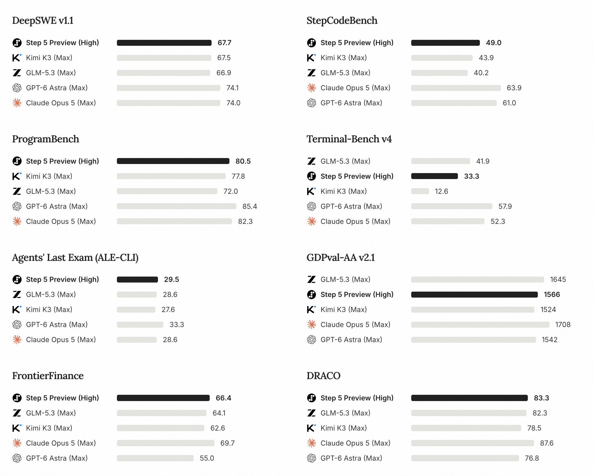

<h1 align="center">
  
  Step 5 Preview
</h1>

<p align="center">
  <a href="https://huggingface.co/stepfun-ai/Step-5-Preview"></a>
  <a href="https://huggingface.co/stepfun-ai/Step-5-Preview-BF16"></a>
  <a href="https://modelscope.ai/models/stepfun-ai/Step-5-Preview"></a>
</p>

<p align="center">
  <a href="https://www.stepfun.com/step-5-preview"></a>
  <a href="https://platform.stepfun.ai/blog/inside-step-5-preview"></a>
  <a href="https://platform.stepfun.ai/docs/en/guides/models/step-5-preview"></a>
  <a href="https://platform.stepfun.ai/"></a>
</p>

## Introduction

Step 5 Preview is StepFun's flagship model for agentic work. It delivers frontier-level performance across software engineering and professional knowledge work, with particular strength in finance.

Step 5 Preview is a sparse Mixture-of-Experts (MoE) model with 600B total parameters and 27B active parameters. It supports up to 1 million tokens of context and accepts text, images, and video, enabling sustained reasoning and tool use across complex tasks.

### Contents

- [Key Capabilities](#key-capabilities)
- [Model Specifications](#model-specifications)
- [Performance](#performance)
- [Deployment](#deployment)
    - [vLLM](#vllm)
    - [Transformers](#transformers)
    - [SGLang](#sglang)
    - [Send a Request](#send-a-request)
- [Resources](#resources)
- [License](#license)

## Key Capabilities

### Software Engineering

Step 5 Preview supports repository-level software engineering, frontend and visual development, and programming for devices. It can navigate large codebases, coordinate changes across files, run and verify code, and iterate on the results.

### Long-Horizon Agentic Execution

Step 5 Preview can carry out tasks that require repeated tool calls, execution, verification, and revision, drawing on long-context information throughout the workflow.

### Professional Knowledge Work

The model combines research, multimodal understanding, and tool use to analyze long documents, charts, screenshots, images, and video, and produce structured reports and analyses.

### A Focus on Finance

Step 5 Preview is particularly strong in financial tasks that combine quantitative reasoning with analysis of financial data and supporting documents.

## Model Specifications

| Specification | Step 5 Preview |
| --- | --- |
| Architecture | Sparse Mixture-of-Experts (MoE) |
| Total Parameters | 600B |
| Active Parameters | 27B |
| Context Window | Up to 1M tokens |
| Maximum Output | Up to 1M tokens |
| Input | Text, image |
| Output | Text |

## Performance

The following results summarize Step 5 Preview's performance across coding, agentic tasks, professional knowledge work, and finance.

<p align="center">
  
</p>

**Evaluation notes**

- Recommended inference settings: `temperature=1.0`, `top_p=0.95`, `top_k=0`.
- Step 5 Preview results shown above use the **High** reasoning setting.
- GDPval-AA v2.1 scores are based on results from [Artificial Analysis](https://artificialanalysis.ai/) as of September 20, 2026.
- DeepSWE v1.1 evaluations use the [SWE-agent](https://github.com/SWE-agent/SWE-agent) harness with `temperature=1.0` and `top_p=0.95`.

For evaluation context, methodology, and detailed case studies, see the [Step 5 Preview Model Page](https://www.stepfun.com/step-5-preview).

## Deployment

Step 5 Preview can be served through an OpenAI-compatible API with vLLM or SGLang, or used for offline generation with the standalone Transformers implementation. The examples below cover FP8 and BF16 checkpoints.

Use a framework build that includes Step 5 Preview support, including the reasoning, tool-call, and speculative decoding features used in the serving commands.

### Deployment Configurations

| Framework | Precision | Hardware | Parallelism | Interface |
| --- | --- | --- | --- | --- |
| vLLM | FP8 | One B300 node, 4 GPUs | TP4, TEP4, or DEP4 | OpenAI-compatible API |
| vLLM | FP8 | One H200 node, 8 GPUs | TP8, TEP8, or DEP8 | OpenAI-compatible API |
| vLLM | BF16 | One B300 node, 8 GPUs | TP8, TEP8, or DEP8 | OpenAI-compatible API |
| vLLM | BF16 | Two H200 nodes, 16 GPUs | TP16, TEP16, or DEP16 | OpenAI-compatible API |
| Transformers | FP8 | One H200 node, 8 GPUs | TP8 / EP8 | Offline generation |
| Transformers | BF16 | Two H200 nodes, 16 GPUs | TP16 / EP16 | Offline generation (see validation note below) |
| SGLang | FP8 | One B300 node, 4 GPUs | TP4 / EP4 | OpenAI-compatible API |
| SGLang | FP8 | One H200 node, 8 GPUs | TP8 / EP8 | OpenAI-compatible API |

DP, TP, and EP refer to data, tensor, and expert parallelism, respectively. TEP combines tensor and expert parallelism; DEP combines data and expert parallelism. These example configurations are sized for the deployments below. Actual memory requirements, usable context length, and concurrency vary with the checkpoint, inference framework, and KV cache allocation.

### vLLM

The examples below expose Step 5 Preview through an OpenAI-compatible API at port `18000`, with `step5` as the model name used in requests.

#### Environment Setup

Pull the Step 5 Preview image and start an interactive container with GPU access:

```bash
docker pull vllm/vllm-openai:step-5-preview

docker run --rm -it \
    --gpus all \
    --ipc=host \
    --network=host \
    --volume "$HOME/.cache/huggingface:/root/.cache/huggingface" \
    --entrypoint /bin/bash \
    vllm/vllm-openai:step-5-preview
```

Run the serving commands below inside the container. If the checkpoint requires authentication, sign in with `hf auth login` before starting the server.

#### FP8: Single Node on 4 B300 GPUs

Choose one of the following parallel configurations for a single node with four B300 GPUs:

| Mode | Tensor parallel | Data parallel | Expert parallel |
| :---: | :---: | :---: | :---: |
| TP4 | 4 | 1 | Disabled |
| TEP4 | 4 | 1 | 4 |
| DEP4 | 1 | 4 | 4 |

Make all four GPUs visible, then run the command for your chosen configuration:

```bash
export CUDA_VISIBLE_DEVICES=0,1,2,3
```

On B300 (Blackwell), the TEP4 and DEP4 commands select MegaMoE with `--moe-backend deep_gemm_mega_moe`. The TP4 command uses the default MoE backend, since MegaMoE requires expert parallelism.

##### TP4: Tensor Parallelism

```bash
vllm serve stepfun-ai/Step-5-Preview \
    --host 0.0.0.0 \
    --port 18000 \
    --served-model-name "step5" \
    --tensor-parallel-size 4 \
    --data-parallel-backend mp \
    --distributed-executor-backend mp \
    --disable-custom-all-reduce \
    --max-model-len 1048576 \
    --max-num-batched-tokens 16384 \
    --max-num-seqs 64 \
    --gpu-memory-utilization 0.85 \
    --enable-prefix-caching \
    --spec-method mtp \
    --spec-tokens 3 \
    --reasoning-parser step5 \
    --enable-auto-tool-choice \
    --tool-call-parser step5
```

##### TEP4: Tensor and Expert Parallelism

```bash
vllm serve stepfun-ai/Step-5-Preview \
    --host 0.0.0.0 \
    --port 18000 \
    --served-model-name "step5" \
    --tensor-parallel-size 4 \
    --enable-expert-parallel \
    --moe-backend deep_gemm_mega_moe \
    --data-parallel-backend mp \
    --distributed-executor-backend mp \
    --disable-custom-all-reduce \
    --max-model-len 1048576 \
    --max-num-batched-tokens 16384 \
    --max-num-seqs 64 \
    --gpu-memory-utilization 0.85 \
    --enable-prefix-caching \
    --spec-method mtp \
    --spec-tokens 3 \
    --reasoning-parser step5 \
    --enable-auto-tool-choice \
    --tool-call-parser step5
```

##### DEP4: Data and Expert Parallelism

```bash
vllm serve stepfun-ai/Step-5-Preview \
    --host 0.0.0.0 \
    --port 18000 \
    --served-model-name "step5" \
    --tensor-parallel-size 1 \
    --data-parallel-size 4 \
    --enable-expert-parallel \
    --moe-backend deep_gemm_mega_moe \
    --data-parallel-backend mp \
    --distributed-executor-backend mp \
    --disable-custom-all-reduce \
    --max-model-len 1048576 \
    --max-num-batched-tokens 16384 \
    --max-num-seqs 64 \
    --gpu-memory-utilization 0.85 \
    --enable-prefix-caching \
    --spec-method mtp \
    --spec-tokens 3 \
    --reasoning-parser step5 \
    --enable-auto-tool-choice \
    --tool-call-parser step5
```

##### FP8 on H200

For a single node with eight H200 GPUs, adapt one of the B300 commands above:

1. Set `CUDA_VISIBLE_DEVICES=0,1,2,3,4,5,6,7`.
2. For TP8 or TEP8, set `--tensor-parallel-size 8`. For DEP8, keep `--tensor-parallel-size 1` and set `--data-parallel-size 8`.
3. For TEP8 or DEP8, retain `--enable-expert-parallel` and remove `--moe-backend deep_gemm_mega_moe`; H200 (Hopper) uses the default MoE backend.

TP and TEP use DP=1; DEP uses TP=1. In all configurations, `--max-num-seqs` applies per DP rank. The 1M-token context limit covers input and output combined. If KV cache memory is insufficient, reduce `--max-model-len` or concurrency.

#### BF16

BF16 deployments require a BF16 checkpoint. Setting `--dtype bfloat16` on the FP8 checkpoint does not convert its quantized weights to BF16.

Mount the BF16 checkpoint directory at the same path inside the container, then set `MODEL` to that path:

```bash
export MODEL="<STEP5_BF16_MODEL_PATH>"
```

Choose a configuration for your hardware:

| Hardware | BF16 layout | MoE backend |
| :---: | :---: | :---: |
| 8 B300 GPUs | TP8, TEP8, or DEP8 | MegaMoE for TEP/DEP; default for TP |
| 2 × 8 H200 GPUs | TP16, TEP16, or DEP16 | Default |

These configurations provide a starting point for loading the BF16 weights. They do not guarantee enough memory for a 1M-token request; KV cache and runtime buffers also require GPU memory.

##### B300: One Node, 8 GPUs

Set `CUDA_VISIBLE_DEVICES=0,1,2,3,4,5,6,7` inside the container. Start from the [TP4 command](#tp4-tensor-parallelism), replace `stepfun-ai/Step-5-Preview` with `"$MODEL"`, and replace `--tensor-parallel-size 4` with one of the argument sets below:

| Mode | Parallel arguments |
| :---: | :--- |
| TP8 | `--tensor-parallel-size 8` |
| TEP8 | `--tensor-parallel-size 8 --enable-expert-parallel --moe-backend deep_gemm_mega_moe` |
| DEP8 | `--tensor-parallel-size 1 --data-parallel-size 8 --enable-expert-parallel --moe-backend deep_gemm_mega_moe` |

Retain the remaining serving arguments, including `--served-model-name "step5"`, `--reasoning-parser step5`, and `--tool-call-parser step5`.

##### H200: Two Nodes, 16 GPUs

Use the same BF16 checkpoint path and container image on both nodes. Replace `<NODE_0_IP>` below with node 0's high-speed-network IP, reachable from node 1. H200 uses the default MoE backend; omit `--moe-backend deep_gemm_mega_moe`.

On each node:

1. Set `MODEL` to the mounted BF16 checkpoint path and `CUDA_VISIBLE_DEVICES=0,1,2,3,4,5,6,7`.
2. Start from the [TP4 command](#tp4-tensor-parallelism) and replace `stepfun-ai/Step-5-Preview` with `"$MODEL"`.
3. Remove `--host`, `--port`, and `--tensor-parallel-size` from that command, then insert the argument block for your configuration and node below. These blocks contain arguments to append to `vllm serve`, rather than standalone commands.

Keep all other serving arguments, including `--data-parallel-backend mp`, `--distributed-executor-backend mp`, the model name, and both parsers. Run one completed command per node. Only node 0 exposes the API, on port `18000`.

**TP16 / TEP16**

For TP16, use the following arguments. For TEP16, also add `--enable-expert-parallel` on both nodes. Both configurations use DP=1.

Node 0:

```text
--host 0.0.0.0 \
--port 18000 \
--tensor-parallel-size 16 \
--nnodes 2 \
--node-rank 0 \
--master-addr <NODE_0_IP>
```

Node 1:

```text
--tensor-parallel-size 16 \
--nnodes 2 \
--node-rank 1 \
--master-addr <NODE_0_IP> \
--headless
```

**DEP16**

DEP16 uses TP=1 and distributes the experts across 16 data-parallel ranks, with eight ranks on each node. Use the same data-parallel address and RPC port on both nodes.

Node 0:

```text
--host 0.0.0.0 \
--port 18000 \
--tensor-parallel-size 1 \
--data-parallel-size 16 \
--data-parallel-size-local 8 \
--data-parallel-address <NODE_0_IP> \
--data-parallel-rpc-port 29550 \
--enable-expert-parallel
```

Node 1:

```text
--tensor-parallel-size 1 \
--data-parallel-size 16 \
--data-parallel-size-local 8 \
--data-parallel-start-rank 8 \
--data-parallel-address <NODE_0_IP> \
--data-parallel-rpc-port 29550 \
--enable-expert-parallel \
--headless
```

### Transformers

The standalone implementation converts checkpoints into shards for offline generation. With its dependencies installed, run the following commands from the `inference/` directory:

```bash
cd inference
```

Use separate checkpoints and output directories for FP8 and BF16. Conversion preserves the source dtype, and generation runs offline without an API server.

#### FP8: One H200 Node, 8 GPUs

Convert the FP8 checkpoint once, then launch eight local processes for TP8 / EP8 generation:

```bash
export STEP5_FP8_CHECKPOINT="<FP8_CHECKPOINT_DIRECTORY>"
export STEP5_FP8_OUT="<FP8_SHARD_OUTPUT_DIRECTORY>"

python3 convert.py \
  --checkpoint "$STEP5_FP8_CHECKPOINT" \
  --tp-size 8 --ep-size 8 --check-only

python3 convert.py \
  --checkpoint "$STEP5_FP8_CHECKPOINT" \
  --out-dir "$STEP5_FP8_OUT" \
  --tp-size 8 --ep-size 8

torchrun --standalone --nproc-per-node=8 generate.py \
  --tp-dir "$STEP5_FP8_OUT/tp8" --ep-size 8 \
  --prompt "Please introduce tensor parallelism." \
  --max-new-tokens 128
```

#### BF16: Two H200 Nodes, 16 GPUs

For TP16 / EP16 generation across two nodes, first convert the BF16 checkpoint into 16 shards. Make the resulting `tp16/` and `tokenizer_files/` directories accessible to both nodes:

```bash
export STEP5_BF16_CHECKPOINT="<BF16_CHECKPOINT_DIRECTORY>"
export STEP5_BF16_OUT="<BF16_SHARD_OUTPUT_DIRECTORY>"

python3 convert.py \
  --checkpoint "$STEP5_BF16_CHECKPOINT" \
  --tp-size 16 --ep-size 16 --check-only

python3 convert.py \
  --checkpoint "$STEP5_BF16_CHECKPOINT" \
  --out-dir "$STEP5_BF16_OUT" \
  --tp-size 16 --ep-size 16
```

Then run the command below on each node, using the same `MASTER_ADDR`, `MASTER_PORT`, and shard output path. Set `NODE_RANK=0` on node 0 and `NODE_RANK=1` on node 1:

```bash
export STEP5_BF16_OUT="<BF16_SHARD_OUTPUT_DIRECTORY>"
export MASTER_ADDR="<NODE_0_REACHABLE_IP_OR_HOSTNAME>"
export MASTER_PORT=29500
export NODE_RANK=0  # Set to 1 on node 1.

torchrun --nnodes=2 --nproc-per-node=8 \
  --node-rank="$NODE_RANK" \
  --master-addr="$MASTER_ADDR" \
  --master-port="$MASTER_PORT" \
  generate.py \
  --tp-dir "$STEP5_BF16_OUT/tp16" --ep-size 16 \
  --prompt "Please introduce tensor parallelism." \
  --max-new-tokens 128
```

This launches 16 processes across the two nodes, matching the 16-shard checkpoint and `--ep-size 16`. The two-node launch uses a shared rendezvous address rather than `--standalone`.

**BF16 validation:** The full BF16 `convert.py → generate.py --tp-dir` file-shard workflow has not yet been validated end to end. The reference implementation has validated checkpoint names and shapes, BF16 small-model conversion, loading and generation, and full-model streaming-weight inference.

### SGLang

#### Environment Setup

Pull the Step 5 Preview SGLang Docker image:

```bash
docker pull lmsysorg/sglang:step-5-preview
```

Launch the server using the configuration for your hardware. For more optimized configurations, including MegaMoE, attention data parallelism, and HiCache, see the [SGLang Cookbook for Step 5 Preview](https://docs.sglang.io/cookbook/autoregressive/StepFun/Step-5-Preview).

#### B300: TP4/EP4, 4 GPUs

This configuration uses MegaMoE for the FP8 routed experts.

```bash
export CUDA_VISIBLE_DEVICES=0,1,2,3

python -m sglang.launch_server \
  --trust-remote-code \
  --model-path stepfun-ai/Step-5-Preview \
  --served-model-name step5 \
  --tp 4 \
  --ep-size 4 \
  --moe-runner-backend flashinfer_trtllm \
  --moe-a2a-backend megamoe \
  --attention-backend fa4 \
  --page-size 64 \
  --kv-cache-dtype bfloat16 \
  --mem-fraction-static 0.9 \
  --swa-full-tokens-ratio 0.03 \
  --chunked-prefill-size 16384 \
  --max-running-requests 64 \
  --cuda-graph-backend-prefill breakable \
  --flashinfer-allreduce-fusion-backend trtllm \
  --speculative-algorithm EAGLE \
  --speculative-num-steps 3 \
  --speculative-eagle-topk 1 \
  --speculative-num-draft-tokens 4 \
  --enable-multi-layer-eagle \
  --reasoning-parser step5 \
  --tool-call-parser step5 \
  --host 0.0.0.0 \
  --port 30000
```

#### H200: TP8/EP8, 8 GPUs

For single-node H200 serving with Triton MoE and FA3 attention.

```bash
export CUDA_VISIBLE_DEVICES=0,1,2,3,4,5,6,7

python -m sglang.launch_server \
  --trust-remote-code \
  --model-path stepfun-ai/Step-5-Preview \
  --served-model-name step5 \
  --tp 8 \
  --ep-size 8 \
  --moe-runner-backend triton \
  --attention-backend fa3 \
  --page-size 64 \
  --kv-cache-dtype bfloat16 \
  --mem-fraction-static 0.9 \
  --swa-full-tokens-ratio 0.03 \
  --chunked-prefill-size 16384 \
  --max-running-requests 64 \
  --cuda-graph-backend-prefill breakable \
  --flashinfer-allreduce-fusion-backend trtllm \
  --speculative-algorithm EAGLE \
  --speculative-num-steps 3 \
  --speculative-eagle-topk 1 \
  --speculative-num-draft-tokens 4 \
  --enable-multi-layer-eagle \
  --reasoning-parser step5 \
  --tool-call-parser step5 \
  --host 0.0.0.0 \
  --port 30000
```

### Send a Request

Once the server is ready, use the base URL for your deployment:

| Serving configuration | Base URL on the server host |
| --- | --- |
| vLLM FP8 | `http://localhost:18000` |
| vLLM BF16 | `http://localhost:18000` (node 0) |
| SGLang FP8 | `http://localhost:30000` |

The example below targets vLLM FP8:

```bash
curl http://127.0.0.1:18000/v1/chat/completions \
    --header 'Content-Type: application/json' \
    --data '{
      "model": "step5",
      "messages": [{"role": "user", "content": "Hello!"}],
      "max_tokens": 4096,
      "stream": true
    }'
```

## Resources

- [Step 5 Preview Model Page](https://www.stepfun.com/step-5-preview) — Model overview, evaluation context, and long-horizon case studies.
- [Step 5 Preview Technical Blog](https://platform.stepfun.ai/blog/inside-step-5-preview) — Model architecture, training stability, Sparse GQA, agentic data synthesis, and reinforcement learning.
- [Documentation](https://platform.stepfun.ai/docs/en/guides/models/step-5-preview) — Official documentation and developer guides.
- [API Platform](https://platform.stepfun.ai/) — Model access and platform services.
- [StepFun Website](https://www.stepfun.com/) — Company information and model announcements.

## License

This model, including its weights, parameters, configuration, tokenizer, model-specific code, and documentation, is licensed under the StepFun Model License 1.0. The full text of the License is available in the [LICENSE](LICENSE) file in this repository. The StepFun Model License 1.0 is an Apache-2.0-Style license, with additional attribution and commercial-license conditions specific to model use, modification and distribution.

Where accompanying materials in this repository, including sample code, datasets, third-party components and other documentation, are separately marked as subject to a different license, such materials are licensed under that license.
